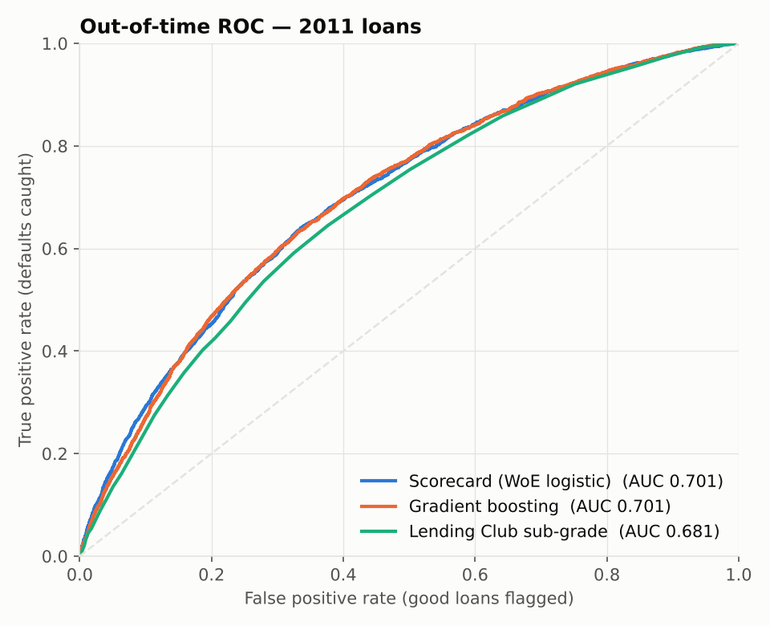
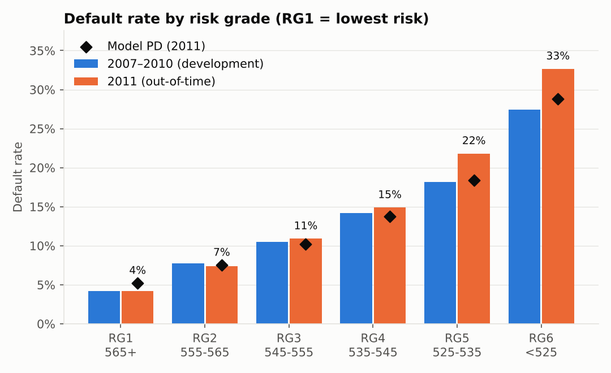
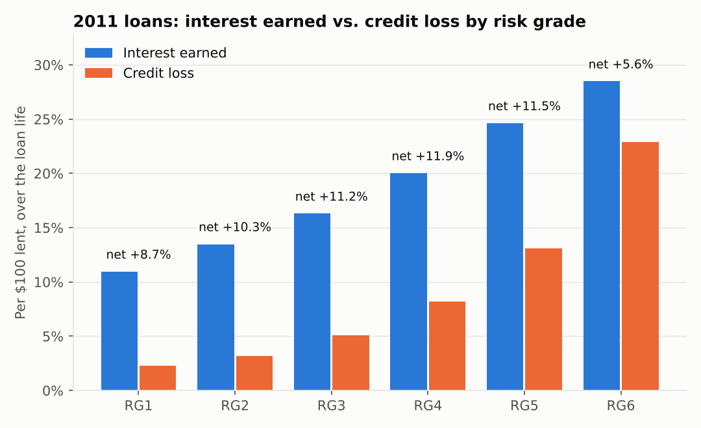

# Credit Default Prediction — PD Scorecard, Risk Grades & Expected Loss

A probability-of-default (PD) model on **38,577 real Lending Club consumer loans (2007–2011)**, built the way a bank's credit risk team would build one:

- leakage-free application data
- an out-of-time test on unseen 2011 loans
- an explainable points scorecard and six risk grades
- loss given default measured from actual recoveries
- expected loss compared with the interest each grade earned

**Main file:** [`credit_default_model.ipynb`](credit_default_model.ipynb). It is fully executed, so all results are visible on GitHub.

## Key results

| Model (tested on 2011 loans, trained on 2007–2010) | AUC | Gini | KS |
|---|---|---|---|
| **WoE logistic scorecard (champion)** | **0.701** | **0.402** | **0.305** |
| Gradient boosting (challenger) | 0.701 | 0.401 | 0.301 |
| Lending Club's own sub-grade (benchmark) | 0.681 | 0.361 | 0.268 |
| Scorecard + Lending Club sub-grade | 0.715 | 0.430 | 0.321 |

- **The scorecard ranks defaults better than Lending Club's own grades**, even without the FICO scores that Lending Club used. Adding it on top of the sub-grade lifts AUC from 0.681 to 0.715, so it captures risk the grade missed.
- **Gradient boosting gave no gain**, so the transparent scorecard is the champion. Every point can be explained to an applicant or a regulator.
- **The ranking held up but calibration drifted.** The 2011 applicant mix was stable (PSI = 0.027, well below the 0.10 threshold), but defaults rose to 15.9% from 13.1%. The model predicted 14.4%, so the PDs need recalibrating while the ranking can be kept.
- **Recoveries are very low.** Loss given default is 93.1% of the balance at default, and 59.4% of the original loan is lost when a loan defaults.
- **The riskiest grade is underpriced.** In RG6, credit losses of 22.9% consume most of the 28.5% interest earned, leaving a 5.6% net yield versus 11–12% in the middle grades. These loans need higher pricing or tighter approval.



## Risk grades (2011 out-of-time)

| Grade | Score | Share of loans | Model PD | Actual default rate | Expected loss | Realized loss | Interest earned | Net yield |
|---|---|---|---|---|---|---|---|---|
| RG1 | 565+ | 11.3% | 5.2% | 4.2% | 3.1% | 2.3% | 10.9% | 8.7% |
| RG2 | 555–565 | 15.6% | 7.5% | 7.4% | 4.5% | 3.2% | 13.5% | 10.3% |
| RG3 | 545–555 | 21.3% | 10.2% | 10.9% | 6.1% | 5.1% | 16.3% | 11.2% |
| RG4 | 535–545 | 19.1% | 13.7% | 14.9% | 8.2% | 8.2% | 20.0% | 11.9% |
| RG5 | 525–535 | 14.6% | 18.4% | 21.8% | 10.9% | 13.1% | 24.6% | 11.5% |
| RG6 | <525 | 18.0% | 28.8% | 32.7% | 17.1% | 22.9% | 28.5% | 5.6% |

*Losses and interest are lifetime amounts per $100 lent, before servicing and funding costs. Expected loss = model PD × 59.4% severity.*




## Method

1. **Target.** Default = "Charged Off". The 1,140 loans still current are excluded because their outcome is unknown.
2. **No leakage.** Only information known at origination is used. Payment and recovery fields are used only to measure loss. Lending Club's grade and interest rate are kept out of the model as a benchmark.
3. **Features.** Engineered features include payment-to-income, loan term, revolving utilization, recent credit inquiries, income, revolving balance to income, public records and loan purpose.
4. **Weight of Evidence.** Each feature is binned (six quantile bins), and features with Information Value below 0.02 are dropped. One feature that overlapped heavily with payment-to-income was also removed because its coefficient had the wrong sign.
5. **Scorecard scaling.** 600 points = 50:1 good:bad odds, and every 20 points doubles the odds. Points per bin are in [`scorecard_points.csv`](scorecard_points.csv).
6. **Validation.** Out-of-time test on 2011 loans with AUC, Gini, KS, Brier score, calibration by grade and the Population Stability Index.
7. **Loss given default and exposure at default.** From charged-off development loans: EAD = funded amount − principal repaid; LGD = 1 − (recoveries − collection fees) / EAD.

## Limitations

- The public data has no FICO or detailed credit bureau attributes.
- Loans still current were excluded.
- Losses are before servicing and funding costs.
- The data covers one lender and one period (2007–2011).

## Run it

```bash
pip install -r requirements.txt
jupyter notebook credit_default_model.ipynb
```

The notebook downloads the data (about 35 MB) automatically from a public GitHub mirror of the Lending Club 2007–2011 dataset ([original on Kaggle](https://www.kaggle.com/datasets/imsparsh/lending-club-loan-dataset-2007-2011)).

*Tools: Python (pandas, scikit-learn, matplotlib), Jupyter.*
